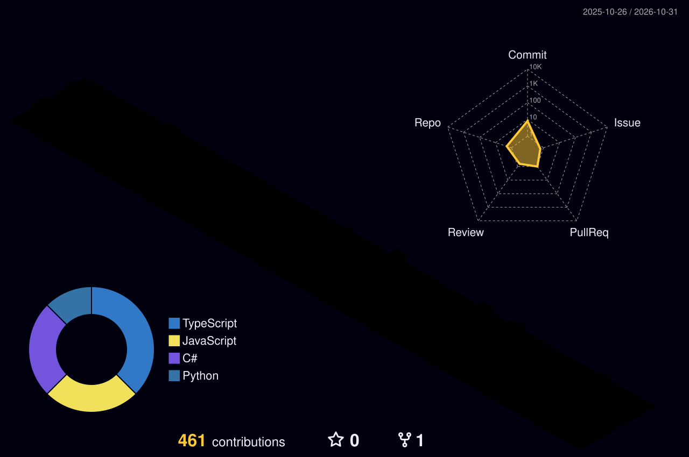

<strong>I'm a Senior Software Engineer</strong> 💻
&nbsp;

 |  |  |  
 | ----------- | ----------- |

&nbsp;

 

 
&nbsp;
&nbsp;

# My Skills
### At the moment
#### Main Stack:

&nbsp;
&nbsp;
&nbsp;
&nbsp;
&nbsp;
&nbsp;

#### Databases:

&nbsp;
&nbsp;

#### Workstation Tools:

&nbsp;
&nbsp;
&nbsp;
&nbsp;

&nbsp;
&nbsp;

##
   

     
  

# Contacts:

 
<a href="https://www.linkedin.com/in/samuelmacielsantos/" target="_blank">

&nbsp;&nbsp;

